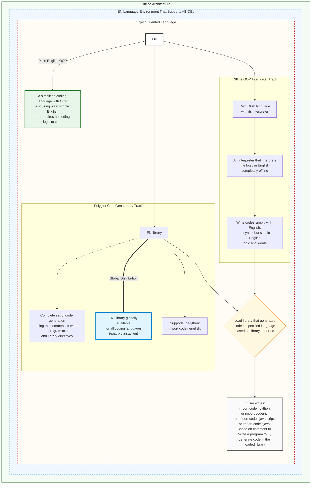

# Code in English Python Library

`codeinenglish` is the offline Python implementation for Code in English. It translates documented English-like instructions and a growing set of DSA problem descriptions in `.en` files into editable Python. It uses deterministic rules and Python's standard library; it does not download models, contact a service, or execute generated programs.

## Architecture

The following diagram illustrates the architecture of the EN Language, showing the offline runtime, universal IDE integration, conversational OOP interpreter, and polyglot code generation library:



*(Source architecture diagram: [docs/architecture.png](docs/architecture.png))*

## Install from this repository

```sh
python3 -m pip install git+https://github.com/anaslari23/EN-Library.git@feat/en-architecture
```

For a local checkout, run `python3 -m pip install .` from the checkout. Then use the library from Python:

```python
import codeinenglish

source = codeinenglish.translate('show "Hello"')
output_path = codeinenglish.solve_file("problem.en")
output_path = codeinenglish.generate_file("program.en")
```

`generate_file` reads one shared source contract. In `en 0.2`, `#?` lines mark a problem request and ordinary `#` comments are documentation. `en 0.1` and headerless files retain their legacy behavior; headerless inputs emit a deprecation warning. Generated files receive deterministic provenance headers, and generation never executes them. A Python `import codeinenglish` also acts on `# write a program to ...` comments in the importing script: it generates the requested function and binds it in that script's namespace (supported problem families only; other scripts are unaffected).

Public API: `CodeInEnglishError`, `translate`, `translate_file`, `solve`, `solve_file`, and `generate_file`.

## CLI

```sh
python3 -m codeinenglish translate greeting.en
python3 -m codeinenglish solve problem.en
python3 -m codeinenglish generate any_program.en
python3 -m codeinenglish check any_program.en --json
python3 -m codeinenglish generate any_program.en --json
python3 -m codeinenglish migrate any_program.en
```

`generate` is the normal one-command workflow. It selects the problem solver for a marked problem request and otherwise translates supported English instructions. `check --json` validates source without writing. `generate --json` writes output and returns the same JSON run plan; `written` becomes true only after the atomic write succeeds. `migrate` prints a diff by default; use `--write` to apply a migration after generated-body equivalence has been checked. Generated code is never run by the generator. Review it before executing.

A version 0.2 problem file can look like:

```text
en 0.2
target python
#? Find two numbers that add up to the target.
#? Return their indices. Exactly one solution exists.
```

The offline recognizer currently covers common array/string families including two-sum indices, duplicates, frequencies, palindrome/anagram checks, binary search, extrema/sum, first unique character, reverse text, moving zeros, merging sorted lists, maximum subarray sum, balanced delimiters, and ascending numeric sort. Supported wording and assumptions are documented in the language repository. This is deterministic rule-based recognition, not unrestricted English understanding; unsupported or ambiguous prompts produce diagnostics rather than guessed code. The shared contract is available through `codeinenglish.read_contract` and structured `Diagnostic` values.

`target javascript` is an early second backend. It supports literal/name assignments and `show` in instruction files, and ascending numeric sort comment problems. `generate` writes `.js`; run that output with Node.js. Other JavaScript constructs and problem families fail explicitly. The Python backend retains its wider coverage.

Internally, English instructions become a typed `Program`; comment requests become a typed `ProblemSpec`. Python AST is created only after recognition, in the Python renderer. This boundary lets a later language backend reuse the English interpretation.

## Development

The distribution has no runtime dependencies and supports Python 3.9+ (the Python that ships with macOS). Run its self-contained tests with:

```sh
python3 -m unittest discover -s tests -v
```

Test fixtures live in `tests/fixtures/`; the package suite does not need the separate language repository.

## Finding wordings to support

Logging is off by default and never leaves your machine. To record requests that could not be generated, set `CODEINENGLISH_MISSES` to a file path, use the tool as usual, then run `python -m codeinenglish misses` to list each distinct request with its count, most frequent first. Frequent misses are the next recipes or wordings to add.

## Run it with nothing installed

No `pip`, no editor extension: build one file and copy it anywhere that has Python 3.9 or newer (the Python that ships with macOS is enough).

```sh
python3 scripts/build_zipapp.py        # writes dist/en.pyz (about 70 KB)
python3 dist/en.pyz run program.en     # or: ./dist/en.pyz run program.en
python3 dist/en.pyz generate program.en
```

Scripts can use `import codeinenglish` with `PYTHONPATH=dist/en.pyz`. The built-in stdio LSP server (`python3 -m codeinenglish lsp`) provides universal IDE diagnostics without requiring any editor extensions.

## Nothing at all? Rebuild it from memory

`seed/` holds the EN core language as a phrasebook small enough to retype (`en.py` 3.9 KB, `en.js` 1.4 KB). It generates Python, JavaScript and C. See `seed/README.md`. `target c` in the full tool covers the same core.

